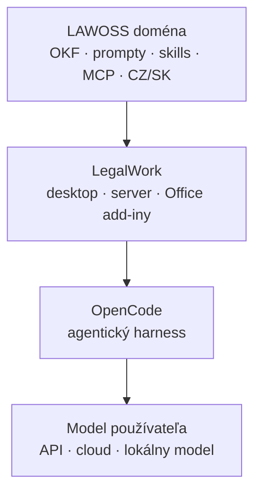

<div align="center">


# LAWOSS

### Czechia · Slovakia

**Open-source AI pracovné prostredie pre českých a slovenských advokátov**

*Poriadok v spise. Overené právo. AI pod kontrolou.*

[](https://github.com/originalmagneto/lawOSS-like-SK-CZ/blob/main/planning/roadmap.md)
[](https://github.com/eigenweltlabs/legalwork)
[](LICENSE)
[](https://github.com/originalmagneto/lawOSS-like-SK-CZ/blob/main/docs/vision.md)


</div>

> [!IMPORTANT]
> LAWOSS je v aktívnom vývoji. Stav zdrojového kandidáta nižšie nepreukazuje dostupnosť ani akceptáciu verejného inštalátora. Testovacie scenáre vykonávajte so syntetickými alebo verejnými údajmi.

## Dostupnosť v zdrojovom kandidátovi — 18. 10. 2026

Táto tabuľka opisuje lokálny implementačný kandidát nad základom `fdd10927d92aaf4c25217430cc316ef38e4e8057`. Nie je zoznamom schopností už nainštalovaného alebo verejne vydaného balíčka. Aktívny postup overovania je v [akceptačnom protokole](docs/lawoss-alpha-acceptance.md).

| Oblasť | Implementované a aktuálne obmedzenia |
|---|---|
| **Prehľad praxe** | Agreguje klientov vo vybranom rozsahu praxe vrátane samostatne pripojených klientov. Ukazuje pokrytie a čerstvosť jednotlivých zdrojov; nedostupný zdroj sa nesmie zobraziť ako nula lehôt. Klienti mimo zvoleného rozsahu nie sú súčasťou prehľadu. |
| **Dokument → lehota → OKF → kalendár** | Technická cesta obsahuje zdroj alebo presný ručný výňatok, dôkaz doručenia, výpočet, natívne potvrdenie hostiteľom, zápis OKF a lokálny ICS. Predvolene je vypnutá: hostiteľ musí štartovať s `LAWOSS_DEADLINE_WORKFLOW=1`, potom sa otvára cez **Settings → Pokročilý → Experimenty → Lhůty**. Pribalené CZ/SK RulePacky sú `synthetic_only`; potvrdenie a export reálnych lehôt zostávajú blokované do samostatného schválenia presného pravidla zodpovedným právnikom. Podrobnosti: [workflow lehôt](lawoss/deadlines/README.md). |
| **Poučenie a AI** | Onboarding a nastavenia používajú jednotné poučenie; jeho prečítanie ani pripojenie poskytovateľa nie je povolenie prenosu. Samostatný verejný/syntetický text možno spracovať v prázdnom oddelenom prostredí spravovaného enginu po natívnej kontrole úplnej skutočnej požiadavky. Chránený alebo neznámy kontext v chate, prílohách, queue/Fusion, vzdialenom OCR, SystemOne a živom hlasovom režime zostáva blokovaný: test H1 nepreukázal izoláciu pri priamom shell prístupe. Platí to aj pre localhost. Ručná práca so súbormi a postup bez modelu zostávajú dostupné. |
| **Identita buildu a distribúcia** | Kód rozlišuje vloženú identitu buildu, finálne inštalačné bytes, podpis, natívnu akceptáciu a publikáciu. Zdrojové testy tieto stavy nenahrádzajú. Vyžaduje sa overenie presného balíčka na deklarovanej platforme a čistom aj migrovanom profile; pozri [release evidence](docs/release-evidence.md). Lokálna implementácia neznamená push, merge ani verejné vydanie. |

[Odovzdanie Logo B a sidebar z 10. 9. 2026](docs/2026-09-10-logo-b-sidebar-handoff.md) je historický technický zápis.

## Čo je LAWOSS

Živý Voice Mode je v tomto kandidátovi blokovaný. Vstavaný lokálny recorder a lokálna transkripcia sú samostatné cesty. Technické odlišnosti LAWOSS a zachované upstream podmienky sú oddelené v [TERMS.md](TERMS.md).

LAWOSS je česká a slovenská open-source vrstva nad projektom [LegalWork](https://github.com/eigenweltlabs/legalwork). Spája lokálne agentické pracovné prostredie s právnymi workflowmi, otvorenými promptmi, skills a MCP konektormi pre naše jurisdikcie.

Základom zostáva upstream LegalWork. Všeobecne použiteľné opravy a lokalizácie chceme ponúkať späť upstreamu. Naše právne workflowy držíme v samostatných adresároch, aby zostali prenositeľné a aby bol fork dlhodobo udržateľný.

| | |
|---|---|
| **Organizácia** | [Omni Legal Products](https://github.com/Omni-Legal-Products) |
| **Koordinácia a rozhodnutia** | [lawOSS-like-SK-CZ](https://github.com/originalmagneto/lawOSS-like-SK-CZ) |
| **Produktový kód** | tento repozitár |
| **Upstream** | [eigenweltlabs/legalwork](https://github.com/eigenweltlabs/legalwork) |
| **Licencia** | MIT, so zachovanou atribúciou Eigenwelt Labs |

## Päť pilierov

| | |
|---|---|
| 📂 **Inteligentné spisy a úlohy** | OKF štruktúra, validácia a lehoty pod kontrolou |
| 🎙️ **Transkripcia a zápisy** | Lokálne spracovanie a prepojenie so spisom |
| ⚖️ **Overené právne zdroje CZ a SK** | Slov-Lex, judikatúra a registre cez MCP |
| 🔓 **Otvorený prompt layer** | Žiadny black box, verzované prompty a skills |
| 🔒 **Lokálne dáta a bezpečnostné brány** | Advokát zostáva rozhodujúcim človekom v procese |

## Čo staviame ako prvé — produktové ciele

LegalWork poskytuje základ pre chat, lokálneho agenta, Office add-iny, transkripciu a správu MCP serverov. Nasledujúca tabuľka vyjadruje zamýšľané ciele LAWOSS; dostupnosť v aktuálnom kandidátovi určuje tabuľka vyššie a akceptácia konkrétneho buildu.

| Oblasť | Cieľ |
|---|---|
| 🇸🇰🇨🇿 **SK a CZ lokalizácia** | Kompletné rozhranie a právne názvoslovie pre obe jurisdikcie |
| 📁 **OKF** | Zakladanie a udržiavanie štruktúrovaných spisov |
| 🔌 **Právne MCP konektory** | Judikatúra, Slov-Lex a ďalšie overené zdroje |
| ⏰ **Lehoty a timeline** | Kontrolovaný výpočet a evidencia lehôt s potvrdením advokáta |
| 📄 **OCR ingest** | Prevod dokumentov do čistého, agenticky použiteľného Markdownu |

Podrobný scope, ADR a špecifikácie sú v [koordinačnom repozitári](https://github.com/originalmagneto/lawOSS-like-SK-CZ).

## Autogram — podpisovanie a zaručená konverzia

<table>
<tr>
<td width="120" valign="top"></td>
<td valign="top">

**[Autogram macOS](https://github.com/originalmagneto/autogram-macOS)** je samostatná natívna aplikácia v SwiftUI od rovnakého autora. **Funguje už dnes a používa sa nezávisle od LAWOSS** — nie je to pripravovaná funkcia tohto projektu.

| Modul | Čo rieši |
|---|---|
| **Podpisovanie** | KEP, PAdES, ASiC-E, kvalifikovaná časová pečiatka, grafický podpis, dávkové spracovanie |
| **Zaručená konverzia** | Postup podľa zák. č. 305/2013 Z. z. s detekciou bezpečnostných prvkov, osvedčovacou doložkou a autorizáciou mandátnym certifikátom |
| **Štátne weby** | Rozšírenie do Safari, ktoré podpisovanie na portáloch obslúži cez aplikáciu — potvrdenie kartou alebo mobilom |
| **Register** | Lokálna evidencia konverzií, stavy, vyhľadávanie a CSV export |

</td>
</tr>
</table>

**Čo z toho má LAWOSS dnes:** v nastaveniach v sekcii *Integrations* je karta, ktorá na macOS zistí, či máte Autogram nainštalovaný, a podľa toho ho otvorí alebo odkáže na jeho vydania. **Hlbšie prepojenie sa pripravuje** — LAWOSS zatiaľ Autogramu neodovzdáva dokumenty ani neriadi jeho beh.

> [!NOTE]
> Autogram je samostatný projekt s vlastným repozitárom a vlastným životným cyklom. Nie je súčasťou tohto forku a nevzťahuje sa naň licencia LAWOSS.

## Vizuálny smer

> [!NOTE]
> Nasledujúce obrázky sú koncepty, nie snímky hotového produktu. Dáta v nich sú vymyslené.

<div align="center">


<br><br>


</div>

## Architektúra rozšírení



Pracujeme v troch zónach:

| Zóna | Obsah | Pravidlo |
|---|---|---|
| 🟢 **Naše adresáre** | `lawoss/**`, CZ/SK locale a dokumentácia | Prednostné miesto pre našu prácu |
| 🟡 **Evidované zásahy** | Branding, registrácia locale a nevyhnutné upstream úpravy | Každá zmena patrí do [`PATCHES.md`](PATCHES.md) |
| 🔴 **Zakázaná zóna** | LegalMemory AGPL plugin, extension registry, svojvoľný bump OpenCode | Zmena iba po novom ADR |

## Tím

| Člen | Zameranie |
|---|---|
| [Marián Čuprík](https://github.com/originalmagneto) | SK jurisdikcia, integrácie a upstream sync |
| [Vojta Říha](https://github.com/LexaurinTheDog) | CZ jurisdikcia, lokalizácia a technické návrhy |
| [Igor Ribár](https://github.com/igorribar) | Advokátska prax a produktové overovanie |
| [Martin Friedrich](https://github.com/BiggusDicckkus) | Lehoty, právne workflowy a bezpečnostné brány |

## Vývoj

Použite Node.js 24, `pnpm@11.4.0` a Bun `1.4.2`, ktorý je pripnutý v aktuálnych hlavných CI workflowoch. Požiadavky konkrétnej platformy a spravovaného OpenCode enginu overte podľa príslušného build workflowu a [návodu pre testerov](docs/lawoss-build-pre-testerov.md).

```bash
pnpm install
pnpm dev
```

Pred otvorením PR spustite minimálne:

Desktop builds also require the bundled protected-execution resources. See [the sandbox build instructions](docs/security/agent-sandbox.md#build-and-verify) to build them locally or use the platform artifacts from the **Protected execution runtime** workflow. Released installers include these resources; users do not install Docker or Python.

```bash
pnpm typecheck
pnpm test:e2e
```

Prečítajte si [`AGENTS.md`](AGENTS.md). Každá zmena ide cez krátku vetvu, pull request, jedno schválenie a zelené CI. Pri zásahu do upstream súboru aktualizujte v tom istom PR aj [`PATCHES.md`](PATCHES.md).

- [Build pre alfa testerov](docs/lawoss-build-pre-testerov.md) — ako si aplikáciu skompilovať a čo hlásiť
- [Akceptačný protokol pre alfu](docs/lawoss-alpha-acceptance.md) — zlatá cesta, provider matica a bezpečné hlásenie výsledku

## Bezpečnosť a modely

- Chránené a neznáme modelové požiadavky sú v tomto kandidátovi blokované; uložený API kľúč ani lokálna adresa túto bránu neotvoria.
- Oddelený test verejného textu vyžaduje spravovaný engine, nakonfigurovaný kompatibilný model a natívne potvrdenie každej skutočnej požiadavky. Poskytovateľ ju dostane podľa vlastných podmienok; toto potvrdenie nie je právne schválenie poskytovateľa.
- Telemetria aplikácie je v LAWOSS trvalo vypnutá. Zachovaný upstream text v [`TERMS.md`](TERMS.md) opisuje upstream produkt a nemení tento technický stav; prenos výslovne potvrdeného verejného textu poskytovateľovi je samostatný tok.
- LAWOSS neposkytuje právne poradenstvo a nenahrádza odborné rozhodnutie advokáta.

## Pôvod a licencia

LAWOSS je fork projektu [LegalWork](https://github.com/eigenweltlabs/legalwork), pôvodne vytvoreného spoločnosťou Eigenwelt Labs. Pôvodná MIT licencia zostáva zachovaná v [`LICENSE`](LICENSE) a atribúcia je uvedená v [`NOTICE`](NOTICE).

Ďakujeme tímom Eigenwelt Labs, OpenCode a Different AI za prácu, na ktorej tento projekt stavia.
