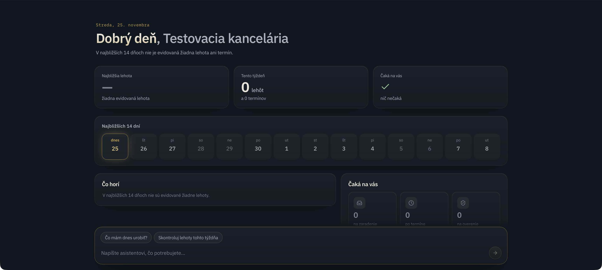
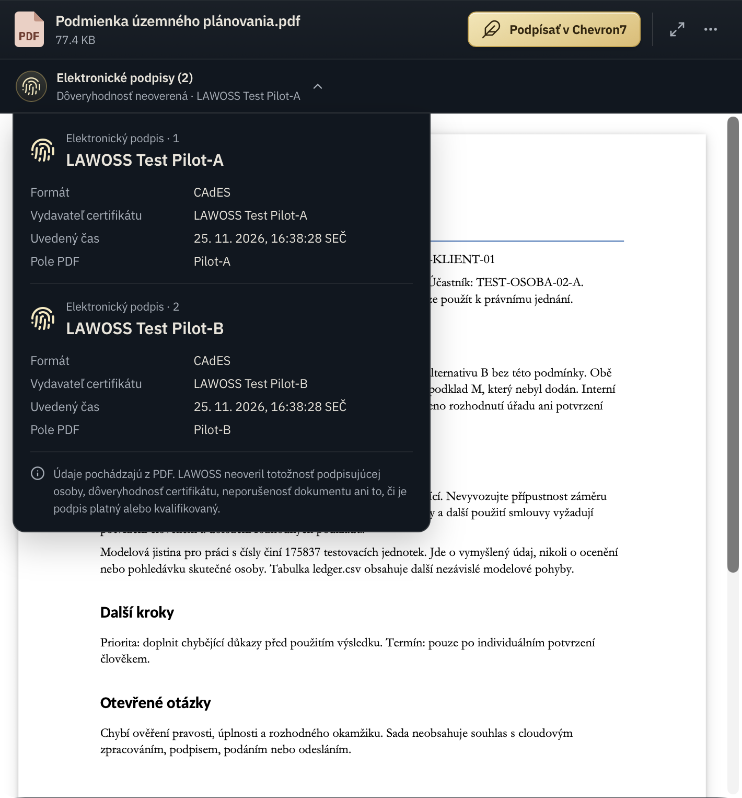
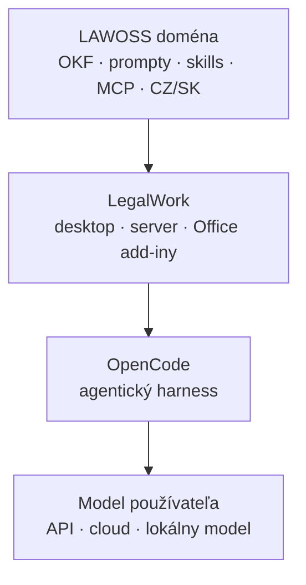

<div align="center">


# LAWOSS

### Czechia · Slovakia

**Open-source AI pracovné prostredie pre českých a slovenských advokátov**

*Poriadok v spise. Overené právo. AI pod kontrolou.*

[](https://github.com/Omni-Legal-Products/lawOSS-like-SK-CZ/blob/main/planning/roadmap.md)
[](https://github.com/eigenweltlabs/legalwork)
[](LICENSE)
[](https://github.com/Omni-Legal-Products/lawOSS-like-SK-CZ/blob/main/docs/vision.md)

</div>

**Chcem vyskúšať LAWOSS s vlastným AI agentom.** Dajte mu odkaz na tento repozitár a pokyn „Pomôž mi vyskúšať LAWOSS na mojom počítači.“ [Postup pre agenta aj testera](docs/tester-agent.md) zahŕňa inštaláciu alebo kompiláciu, syntetický spis a formulár spätnej väzby.


## Vyskúšajte LAWOSS

Pozvaní testeri si z osobného odkazu stiahnu alfu `0.2.1-alpha.20.g875852c` pre macOS s Apple Silicon alebo Windows x64 či ARM64. Skúšajte ju na kópii syntetického spisu. [Inštalácia a testovacie dáta](docs/lawoss-build-pre-testerov.md)

### Čo nájdete v kandidátovi z 25. novembra 2026

Nasledujúce snímky zobrazujú rozhranie pilotnej zostavy na syntetickom spise. Zmeny od alfy 20 sú pripravené na samostatné overenie na Windows.



| Pri práci | Kde funkciu nájdete |
|---|---|
| **Klienti a prípady** | Na obrazovke **Dnes** vidíte úlohy a najbližšie lehoty. V prehľade prípadu môžete ceruzkou upraviť zobrazovaný názov. Priečinok spisu si zachová cestu. |
| **Model a Fast** | V chate vyberiete model a úroveň uvažovania. Ak pripojenie ChatGPT podporuje prioritu daného modelu, vedľa výberu sa zobrazí blesk. Ponuka vychádza z údajov pripojenia alebo zo vstavaného katalógu verzie. |
| **Registre a skills** | **Nastavenia → Integrácie** sprístupnia Marketplace a pridanie vlastného MCP. V chate vidíte názov použitého registra aj neúspešné volanie. V **Nastavenia → Skills** nájdete osobné skilly a import kompatibilných lokálnych balíkov. |
| **PDF a elektronické podpisy** | PDF sa v desktope otvorí na šírku panela. **Nástroje PDF** sprístupnia strany, priblíženie a tlač. Kliknutím na ikonu odtlačku otvoríte dostupné údaje o osobe, certifikáte, formáte a čase. Na Macu zlaté pero otvorí podpisovanie konkrétneho súboru v Chevron7. |

| Čítačka PDF na Macu | Detail dvoch vložených podpisov |
|---|---|
|  |  |

Čítanie údajov o podpise v PDF funguje aj bez Chevron7. Platnosť podpisu, dôveryhodnosť certifikátu a kvalifikovanosť overujte v samostatnom validátore. [Používateľská príručka SK](lawoss/user-guide/sk/index.md) · [Příručka CZ](lawoss/user-guide/cs/index.md) · [Windows skúška pred vydaním](docs/lawoss-build-pre-testerov.md#overenie-kandidáta-na-windows)

**Experiment s výpočtom lehôt.** Hostiteľ ho sprístupní cez `LAWOSS_DEADLINE_WORKFLOW=1`. Pribalené CZ/SK RulePacky slúžia na syntetické skúšky. Potvrdenie a export reálnych lehôt vyžadujú schválenie konkrétneho pravidla zodpovedným právnikom. [Workflow lehôt](lawoss/deadlines/README.md)

## Čo je LAWOSS

Živý Voice Mode je v tomto kandidátovi blokovaný. Vstavaný lokálny recorder a lokálna transkripcia sú samostatné cesty. Technické odlišnosti LAWOSS a zachované upstream podmienky sú oddelené v [TERMS.md](TERMS.md).

LAWOSS je česká a slovenská open-source vrstva nad projektom [LegalWork](https://github.com/eigenweltlabs/legalwork). Spája lokálne agentické pracovné prostredie s právnymi workflowmi, otvorenými promptmi, skills a MCP konektormi pre naše jurisdikcie.

Základom zostáva upstream LegalWork. Všeobecne použiteľné opravy a lokalizácie chceme ponúkať späť upstreamu. Naše právne workflowy držíme v samostatných adresároch, aby zostali prenositeľné a aby bol fork dlhodobo udržateľný.

| | |
|---|---|
| **Organizácia** | [Omni Legal Products](https://github.com/Omni-Legal-Products) |
| **Koordinácia a rozhodnutia** | [lawOSS-like-SK-CZ](https://github.com/Omni-Legal-Products/lawOSS-like-SK-CZ) |
| **Produktový kód** | tento repozitár |
| **Upstream** | [eigenweltlabs/legalwork](https://github.com/eigenweltlabs/legalwork) |
| **Licencia** | MIT, so zachovanou atribúciou Eigenwelt Labs |

## Päť pilierov

| | |
|---|---|
| 📂 **Inteligentné spisy a úlohy** | OKF štruktúra, validácia a lehoty pod kontrolou |
| 🎙️ **Transkripcia a zápisy** | Lokálne spracovanie a prepojenie so spisom |
| ⚖️ **Overené právne zdroje CZ a SK** | Slov-Lex, judikatúra a registre cez MCP |
| 🔓 **Otvorený prompt layer** | Žiadny black box, verzované prompty a skills |
| 🔒 **Lokálne dáta a bezpečnostné brány** | Advokát zostáva rozhodujúcim človekom v procese |

## Produktové ciele

LegalWork poskytuje základ pre chat, lokálneho agenta, Office add-iny, transkripciu a správu MCP serverov. Vývoj LAWOSS má tieto ciele.

| Oblasť | Cieľ |
|---|---|
| 🇸🇰🇨🇿 **SK a CZ lokalizácia** | Kompletné rozhranie a právne názvoslovie pre obe jurisdikcie |
| 📁 **OKF** | Zakladanie a udržiavanie štruktúrovaných spisov |
| 🔌 **Právne MCP konektory** | Judikatúra, Slov-Lex a ďalšie overené zdroje |
| ⏰ **Lehoty a timeline** | Kontrolovaný výpočet a evidencia lehôt s potvrdením advokáta |
| 📄 **OCR ingest** | Prevod dokumentov do čistého, agenticky použiteľného Markdownu |

Podrobný scope, ADR a špecifikácie sú v [koordinačnom repozitári](https://github.com/Omni-Legal-Products/lawOSS-like-SK-CZ).

## Podpisovanie na Macu

Chevron7 môžete nainštalovať z karty integrácie alebo priamo pri PDF. Po výbere súboru dokončíte podpis v aplikácii Chevron7 a podpísaný súbor si otvoríte v čítačke LAWOSS. [Postup s PDF](lawoss/user-guide/sk/klienti-a-pripady.md#elektronické-podpisy-v-pdf)

Chevron7, pôvodne Autogram macOS, sa distribuuje samostatne pod licenciou EUPL 1.2. [Repozitár Chevron7](https://github.com/originalmagneto/chevron7)

## Architektúra rozšírení



Pracujeme v troch zónach:

| Zóna | Obsah | Pravidlo |
|---|---|---|
| 🟢 **Naše adresáre** | `lawoss/**`, CZ/SK locale a dokumentácia | Prednostné miesto pre našu prácu |
| 🟡 **Evidované zásahy** | Branding, registrácia locale a nevyhnutné upstream úpravy | Každá zmena patrí do [`PATCHES.md`](PATCHES.md) |
| 🔴 **Zakázaná zóna** | LegalMemory AGPL plugin, extension registry, svojvoľný bump OpenCode | Zmena iba po novom ADR |

## Tím

| Člen | Zameranie |
|---|---|
| [Marián Čuprík](https://github.com/originalmagneto) | SK jurisdikcia, integrácie a upstream sync |
| [Vojta Říha](https://github.com/LexaurinTheDog) | CZ jurisdikcia, lokalizácia a technické návrhy |
| [Igor Ribár](https://github.com/igorribar) | Advokátska prax a produktové overovanie |
| [Martin Friedrich](https://github.com/BiggusDicckkus) | Lehoty, právne workflowy a bezpečnostné brány |

## Vývoj

Použite Node.js 24.22.1, `pnpm@11.4.0` a Bun `1.4.4`, ktorý je pripnutý v aktuálnych hlavných CI workflowoch. Požiadavky konkrétnej platformy a spravovaného OpenCode enginu overte podľa príslušného build workflowu a [návodu pre testerov](docs/lawoss-build-pre-testerov.md).

```bash
pnpm install
pnpm dev
```

Pred otvorením PR spustite minimálne:

Desktop builds also require the bundled protected-execution resources. See [the sandbox build instructions](docs/security/agent-sandbox.md#build-and-verify) to build them locally or use the platform artifacts from the **Protected execution runtime** workflow. Released installers include these resources; users do not install Docker or Python.

```bash
pnpm typecheck
pnpm test:e2e
```

Prečítajte si [`AGENTS.md`](AGENTS.md). Každá zmena ide cez krátku vetvu, pull request, jedno schválenie a zelené CI. Pri zásahu do upstream súboru aktualizujte v tom istom PR aj [`PATCHES.md`](PATCHES.md).

- [Build pre alfa testerov](docs/lawoss-build-pre-testerov.md) — ako si aplikáciu skompilovať a čo hlásiť
- [Akceptačný protokol pre alfu](docs/lawoss-alpha-acceptance.md) — zlatá cesta, provider matica a bezpečné hlásenie výsledku

## Bezpečnosť a modely

- Chránené a neznáme modelové požiadavky sú v tomto kandidátovi blokované; uložený API kľúč ani lokálna adresa túto bránu neotvoria.
- Oddelený test verejného textu vyžaduje spravovaný engine, nakonfigurovaný kompatibilný model a natívne potvrdenie každej skutočnej požiadavky. Poskytovateľ ju dostane podľa vlastných podmienok; toto potvrdenie nie je právne schválenie poskytovateľa.
- Telemetria aplikácie je v LAWOSS trvalo vypnutá. Zachovaný upstream text v [`TERMS.md`](TERMS.md) opisuje upstream produkt a nemení tento technický stav; prenos výslovne potvrdeného verejného textu poskytovateľovi je samostatný tok.
- LAWOSS neposkytuje právne poradenstvo a nenahrádza odborné rozhodnutie advokáta.

## Pôvod a licencia

LAWOSS je fork projektu [LegalWork](https://github.com/eigenweltlabs/legalwork), pôvodne vytvoreného spoločnosťou Eigenwelt Labs. Pôvodná MIT licencia zostáva zachovaná v [`LICENSE`](LICENSE) a atribúcia je uvedená v [`NOTICE`](NOTICE).

Ďakujeme tímom Eigenwelt Labs, OpenCode a Different AI za prácu, na ktorej tento projekt stavia.
