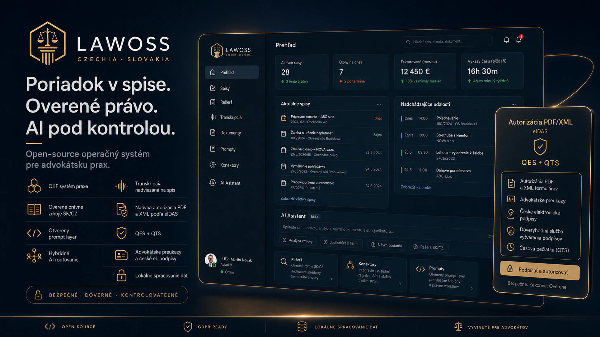
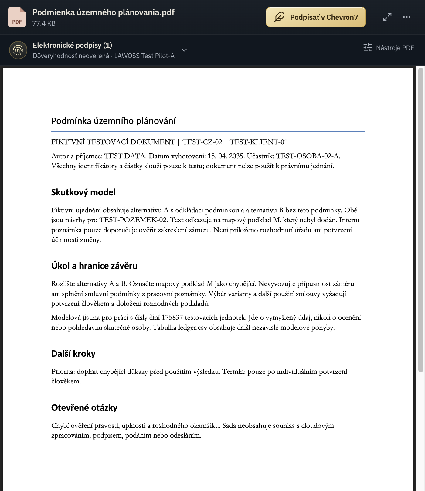
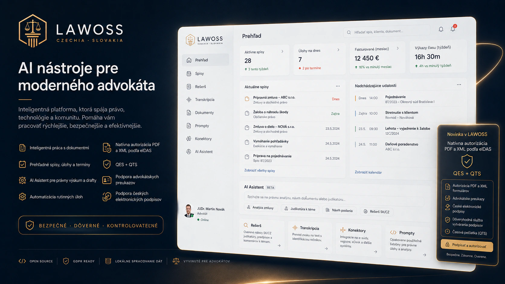
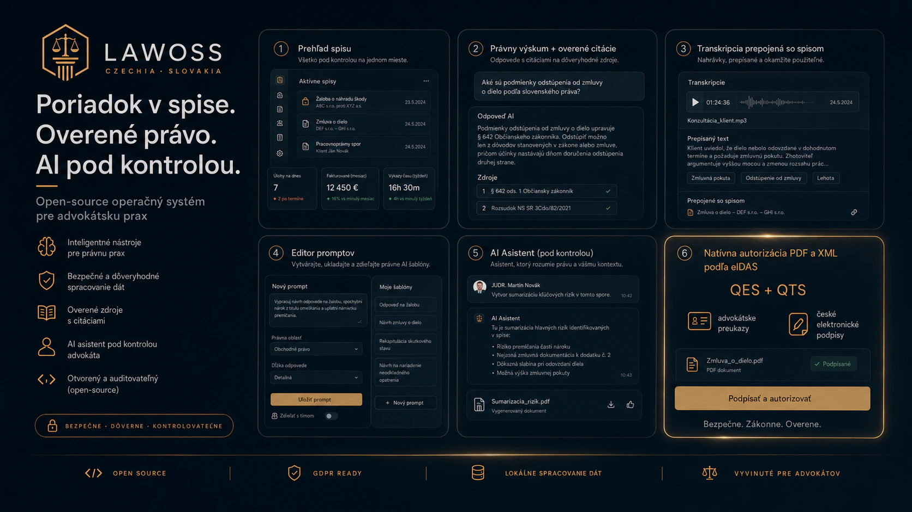
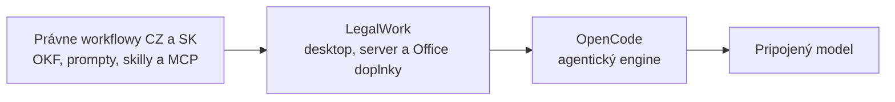

<h1 align="center">LAWOSS</h1>

<p align="center"><strong>Open-source pracovné prostredie pre české a slovenské advokátske kancelárie.</strong><br>
Klienti, súdne spisy, právne zdroje a AI asistent na jednom pracovnom stole.</p>

<p align="center"><a href="https://lawoss.app">Web LAWOSS</a> · <a href="docs/lawoss-build-pre-testerov.md">Vyskúšať alfu</a> · <a href="lawoss/user-guide/sk/index.md">Slovenská príručka</a> · <a href="lawoss/user-guide/cs/index.md">Česká příručka</a></p>

[](docs/images/brand/hero.webp)

*Vizuálny koncept LAWOSS. Spis a jeho podklady zostávajú pred advokátom aj pri príprave výstupu.*

## Od ranného prehľadu k práci na spise

Ráno otvoríte **Dnes** a pozriete si najbližšie evidované lehoty. Vyberiete klienta, prejdete do prípadu a otvoríte dokument vedľa rozhovoru. Keď sa k veci vrátite o týždeň, nájdete jej súbory, doterajší rozhovor aj uloženú pamäť prípadu.

| Čo chcete urobiť | Kde začať |
|---|---|
| Zistiť, čo treba vybaviť | **Dnes** sústreďuje úlohy, lehoty a termíny z prípadov. Agenda sa dá prepnúť z prehľadu na mesiac. [Dnes a lehoty](lawoss/user-guide/sk/dnes-a-lehoty.md) |
| Pracovať s existujúcim spisom | Pripojte priečinok klienta a otvorte prípad. Štruktúra OKF uchováva podklady a pamäť prípadu na disku. [Klienti a prípady](lawoss/user-guide/sk/klienti-a-pripady.md) |
| Nájsť právny podklad | V Marketplace si vyberte balík pre svoju jurisdikciu. Konektory sprístupňujú napríklad Slov-Lex, slovenskú judikatúru a obchodný register. [Integrácie a skilly](lawoss/user-guide/sk/integracie.md) |
| Položiť otázku k dokumentu | Vyberte poskytovateľa a model, otvorte chat prípadu a pridajte konkrétny podklad. Pri práci so vzdialeným modelom záleží na tom, ktoré údaje mu sprístupníte. [Modely, AI hranice a OCR](lawoss/user-guide/sk/ai-a-modely.md) |

## Vyskúšajte LAWOSS na syntetickom spise

**Pozvaní testeri** dostanú cez osobný odkaz inštalátor alfy 20 pre **macOS s Apple Silicon**, **Windows x64** alebo **Windows ARM64**. Návod obsahuje presnú verziu, kontrolné súčty aj postup prvého spustenia. [Inštalácia pre testerov](docs/lawoss-build-pre-testerov.md)

1. Stiahnite [syntetickú kanceláriu](SYNTHETIC_DATA.md), rozbaľte ju a otvorte jeden priečinok klienta.
2. V prehľade nájdite prípad a jeho najbližší termín. Otvorte jeden z dokumentov a porovnajte jeho obsah s údajmi v prehľade.
3. Ak skúšate aj asistenta, položte mu otázku na konkrétny dátum alebo sumu v testovacom dokumente. Otvorte zdroj a skontrolujte odpoveď.

Ak vám pri inštalácii pomáha vlastný AI agent, dajte mu odkaz na tento repozitár a pokyn **„Pomôž mi vyskúšať LAWOSS na mojom počítači.“** [Postup pre agenta](docs/tester-agent.md)

## Ako vyzerá pilotná zostava

Snímky pochádzajú z **interného kandidáta z 25. novembra 2026** a zobrazujú syntetické údaje. Pozvánka uvedená vyššie distribuuje alfu 20. [Zmeny a postup skúšky kandidáta](https://github.com/Omni-Legal-Products/lawoss/blob/b60fdd082864da96e0b85369a298e715e6fc918b/docs/lawoss-build-pre-testerov.md#kontroly-pilotnej-zostavy)

[](docs/screenshots/pilot/dnes.png)

*Dnes v širokom okne. Z prehľadu lehôt a úloh môžete prejsť k prípadu alebo pokračovať otázkou pre asistenta.*

| Čítanie a podpisovanie na Macu | Čo obsahuje podpis |
|---|---|
| [](docs/screenshots/pilot/citacka-pdf.png) | [](docs/screenshots/pilot/podpisy-pdf.png) |
| Zlatým perom **Podpísať v Chevron7** odošlete vybrané PDF do podpisovacej aplikácie. Podpis dokončíte v Chevron7. | Kliknutím na odtlačok zobrazíte podpisy a časové pečiatky vložené v PDF. Na overenie platnosti či kvalifikovanosti podpisu použite samostatný validátor. |

Ak pripojíte klientsky priečinok s vlastným indexom alebo pracovnými poznámkami, v **Prehľade** uvidíte súbory aj pred založením prvého prípadu. Môžete obnoviť údaje z disku, otvoriť index alebo pripraviť otázku pre AI. Správu si pred odoslaním skontrolujete. [Práca s klientskym priečinkom](lawoss/user-guide/sk/klienti-a-pripady.md)

V kandidátovi sa **Fast** zapína bleskom pri modeli priamo v chate, ak ho pripojenie pre daný model ponúka. Pri dokončenom volaní registra vidíte, ktorý zdroj asistent použil. V prehľade prípadu môžete upraviť zobrazovaný názov a v nastaveniach nájdete správu osobných skillov.

## Obrazová galéria návrhov

Pôvodné marketingové ilustrácie zachytávajú návrh pracovného prostredia. Kliknutím ich otvoríte v plnom rozlíšení.

| Kancelária v svetlom motíve | Právna práca v šiestich detailoch |
|---|---|
| [](docs/images/brand/dashboard.webp) | [](docs/images/brand/features.webp) |
| Ako môže advokát prejsť od prehľadu kancelárie k rozpracovanému dokumentu. | Od spisového prehľadu cez výskum s citáciami a prepis až po autorizáciu výstupu. |

## Dáta, modely a lehoty

Súbory prípadu sú uložené v priečinku klienta. V bežnom chate s vypnutými **AI hranicami** dostáva zvolený poskytovateľ text a prílohy, ktoré odošlete. So zapnutými hranicami je bežný chat vypnutý. Aplikačná telemetria LAWOSS je vypnutá. Pre alfu používajte syntetické alebo verejné podklady. [Nastavenia modelov](lawoss/user-guide/sk/ai-a-modely.md) · [Podmienky a pôvod upstreamu](TERMS.md)

Evidované lehoty v prehľade sa líšia od návrhu výpočtu. Experimentálny výpočet používa syntetické české a slovenské pravidlá. Pred použitím konkrétneho pravidla na reálnu lehotu sa vyžaduje jeho odborné schválenie. [Workflow lehôt](lawoss/deadlines/README.md)

## Vývoj a pôvod projektu

LAWOSS vyvíja [Omni Legal Products](https://github.com/Omni-Legal-Products) ako fork [LegalWork](https://github.com/eigenweltlabs/legalwork). Desktopová aplikácia a lokálny server využívajú agentický engine OpenCode. České a slovenské pracovné postupy, prompty, skilly a konektory dopĺňame vo vrstve LAWOSS. [Pravidlá vývoja](AGENTS.md) · [Zásahy do upstreamu](PATCHES.md)

<details>
<summary>Architektúra aplikácie a rozšírení</summary>



Právne workflowy a lokalizácie majú vlastné adresáre. Zásahy do spoločného rozhrania evidujeme v súbore PATCHES.md, aby sa pri aktualizácii upstreamu dali preniesť a otestovať. Koordinačné rozhodnutia a špecifikácie spravuje tím v [samostatnom repozitári s obmedzeným prístupom](https://github.com/Omni-Legal-Products/lawOSS-like-SK-CZ).

</details>

Na lokálny vývoj použite Node.js 24.22.1, pnpm 11.4.0 a Bun 1.4.4.

```sh
pnpm install --frozen-lockfile
pnpm dev
```

Pred PR spustite `pnpm typecheck` a `pnpm test:e2e`. Pri zostavovaní desktopu pribaľte runtime chráneného prostredia podľa [pokynov k zostave](docs/security/agent-sandbox.md#build-and-verify). Pri overovaní inštalátora použite [akceptačný protokol](docs/lawoss-alpha-acceptance.md) a [evidenciu vydania](docs/release-evidence.md).

| Tím | Zameranie |
|---|---|
| [Marián Čuprík](https://github.com/originalmagneto) | Slovenská jurisdikcia, integrácie a synchronizácia s upstreamom |
| [Vojta Říha](https://github.com/LexaurinTheDog) | Česká jurisdikcia, lokalizácia a technické návrhy |
| [Igor Ribár](https://github.com/igorribar) | Advokátska prax a produktové overovanie |
| [Martin Friedrich](https://github.com/BiggusDicckkus) | Lehoty, právne workflowy a bezpečnostné brány |

Projekt zachováva licenciu MIT a atribúciu pôvodných autorov. [Licencia](LICENSE) · [NOTICE](NOTICE). [Chevron7](https://github.com/originalmagneto/chevron7), pôvodne Autogram macOS, je samostatná podpisovacia aplikácia s vlastnou licenciou.
