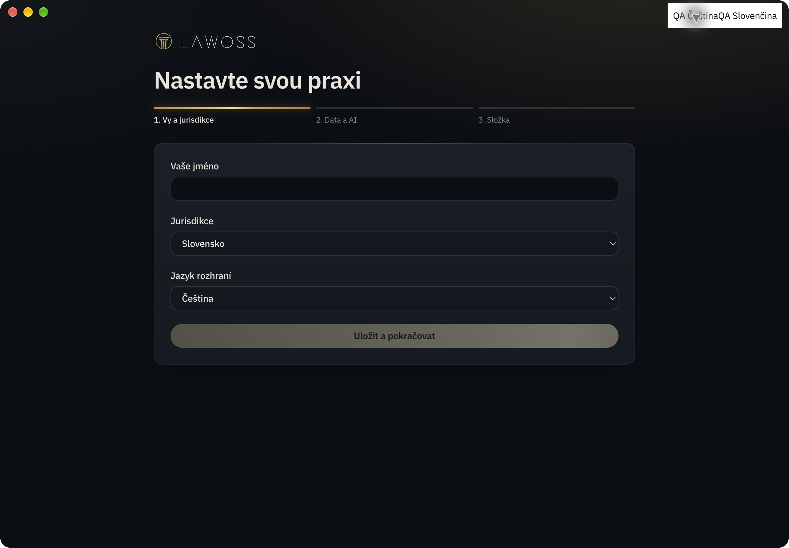

# Czech UI runtime evidence — 2026-10-21

Actual macOS arm64 Electron with the production renderer and a disposable profile. The local language fixture adds the visible QA buttons and calls the production language preference store; it does not replace application components. Switching CS → SK → CS updates both the onboarding and native menu (Soubor → Súbor → Soubor). The selected jurisdiction remains Slovakia throughout. No client files or real Office account were used.

The [AX record](locale-switch.txt) captures Czech application copy and menu labels alongside the Slovak state. Process executable, renderer URL and Vite appRoot were verified locally against the implementation worktree. Development metadata had no embedded Git SHA; this is source-runtime evidence, not packaged release provenance.

Automated verification of this PR’s product code (Node 24.21.0 and CI Bun 1.4.2):

| Check | Result |
| --- | --- |
| App suite | 2875 passed, 2 skipped, no failures |
| Desktop Node suite | 450 passed, 6 skipped, no failures; Actaport prerequisite also passed |
| OKF CLI | 398 passed, 5 skipped, no failures |
| Full server suite | 3015 passed, 67 skipped, no failures |
| Targeted server: Office, templates, original workflow identity | 20 passed |
| Actual Electron host review smoke | All six approval/cancellation paths passed, exact content preserved |
| Presentation audit mutation tests | 3 passed |
| i18n and local CI audit | 7848 keys; app/native/offline Office catalogs passed; root audit exit code 0 after static menu-key correction |
| App, server and Electron typechecks; desktop bridge | Passed |
| App, server and Office production builds | Passed |
| Packaged server import stage | 444 modules loaded; 447 statically checked |
| OKF bundle rebuild | Two matching SHA-256 results with CI Bun 1.4.2 |
| Independent review after fixes | No remaining Important/Critical findings |

Three default-timeout Word tests failed once while builds ran concurrently. The unchanged tests then passed 27/27 alone and in the final full app run after the build; no assertions or time limits were changed.

Real Windows and Word/Excel/PowerPoint hosts were not interactively verified locally. PR CI results are tracked separately in GitHub; this document does not claim they have passed. The original user profile remained separate from the test profile.

PR verification additionally reran `pnpm --filter @legalwork/app test`, `pnpm --filter legalwork-server test`, `pnpm --filter @lawoss/okf typecheck`, `pnpm --filter @legalwork/app test:i18n`, and `pnpm --filter @legalwork/desktop test:host-review`. The first GitHub i18n run correctly rejected a constructed Windows menu key. It was replaced by a static key map; the audit rule was preserved. Prior claims that the initial root audit had passed were incorrect and are corrected by this explicit exit-code check. GitHub results remain separate from local results.
