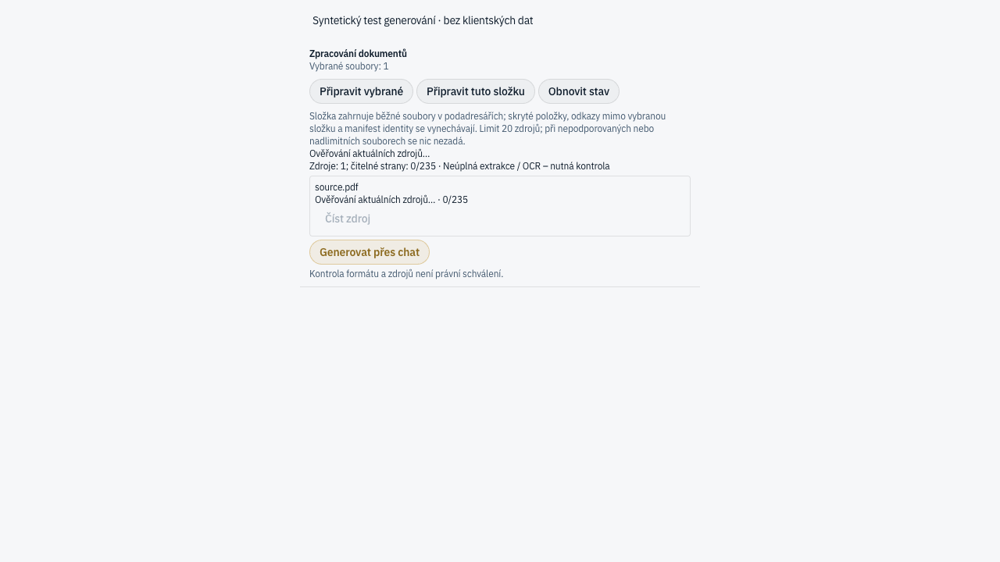

# Generovanie počas overovania zdrojov

Regresia hlásená 17. 10. 2026: dvojsekundový polling zdrojov nastavoval `isFetching`, čo zakaždým zakázalo „Generovať cez chat“. Dlhšie overovanie tak blokovalo spustenie akcie aj po úspešnom predchádzajúcom čítaní.

Tlačidlo teraz môže začať samostatnú čerstvú kontrolu počas background pollingu. Chýbajúce, pending, stale a chybové zdroje zostávajú blokované. Samotné kliknutie musí pred callbackom znovu načítať zoznam aj vybrané zdroje; cache nepovoľuje odoslanie. Overený stav výstupov sa počas pollingu naďalej nepotvrdzuje.

## Dôkazy

- Pred opravou nový unit test zlyhal na zakázanom tlačidle. Rovnaký browser scenár s pôvodnou podmienkou skončil `Generation is disabled by background verification`.
- Po oprave: 28 testov v troch súvisiacich súboroch, 0 zlyhaní; app typecheck prešiel.
- Celá app sada po prenesení na `dev` (`0d264f30`, sync v0.2.9): 2 389 pass, 2 platformové skipy, 0 fail (360 súborov).
- Browser regresia: pri zadržanom background requeste kliknutie vykonalo čerstvé čítanie a jedno syntetické odoslanie. Pri zmene zdroja (`409 document_stale`) zobrazilo chybu bez odoslania.



Browser používa skutočný React panel, QueryClient a HTTP klienta. API odpovede aj callback odoslania sú syntetické. Tento test nedokazuje dokončenie živého modelu ani kvalitu OCR. Existujúce native-generation testy samostatne kontrolujú SDK preflight a životný cyklus prijatého zadania.

## Zopakovanie

Použite Node 24 a pnpm podľa koreňového `package.json`.

```sh
pnpm --filter @legalwork/app exec bun test tests/document-processing-panel.test.tsx tests/document-processing.test.ts tests/native-document-generation.test.ts
pnpm --filter @legalwork/app typecheck
PORT=58763 pnpm --filter @legalwork/app exec vite --host 127.0.0.1
```

V druhom termináli s dostupným `playwright-cli` (oficiálny balík `@playwright/cli`), z koreňa repozitára:

```sh
playwright-cli -s=document-polling open http://127.0.0.1:58763/tests/fixtures/document-generation-polling.html
playwright-cli -s=document-polling run-code --filename apps/app/scripts/document-generation-polling.playwright.js
playwright-cli -s=document-polling close
```

Očakávaný výsledok: `ok: true`, dva scenáre, `sends: 1`. Screenshoty vzniknú v `output/playwright/` pracovného adresára browser session. Fixture je iba dev/test vstup, nie súčasť produkčného Vite buildu.
