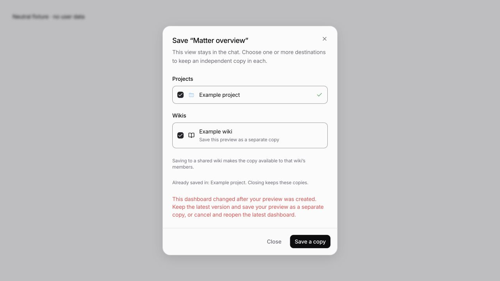
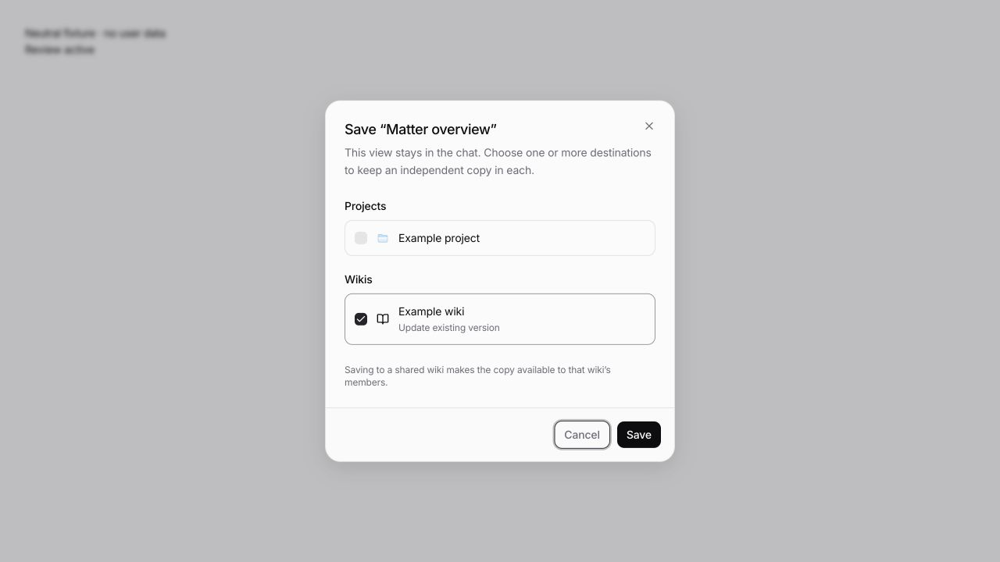
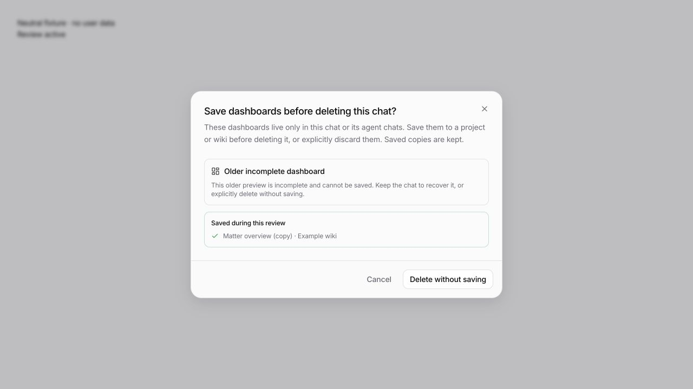
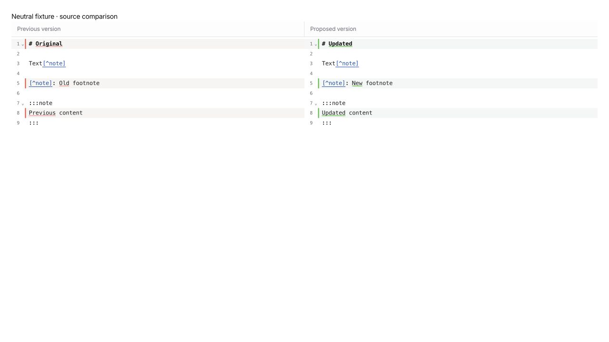
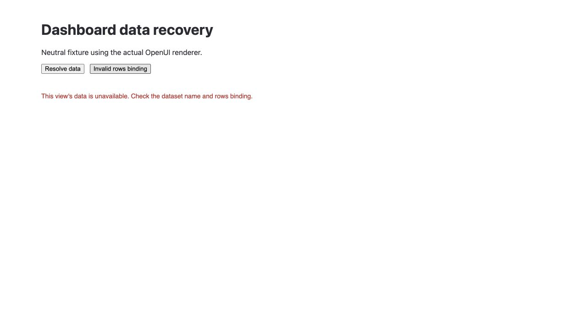

# External adversarial review follow-up — 15 October 2026

The supplied review compared PR #280 at `9cac1e3a9e58d2701261abf471ad5369e5ccf499` with Chris's PR #276 at `0bc6e9c2af7c05753b06452ef61dc352e14e63ff`. We checked the claims against those paths and the current code. An independent verification agent reproduced the stale-grant and strict-schema problems, traced the unmanaged-engine bypass, and rechecked the fixes. Separate agents handled history and client flows; the parent checked integration and the OpenUI browser behavior. No finding quota was used.

## Numbered findings

| # | Assessment and disposition |
| --- | --- |
| 1 | **Confirmed, fixed.** Project grants are revalidated before mounting and committing. Unregister/repath invalidates affected approvals and active commands. A revoked root stays protected in a live chat, so an old generic folder permission cannot restore write access. Deleted chats release their grant state. |
| 2 | **Confirmed, fixed.** Failed deletion displays a localized error, including busy chats/children and network failures. |
| 3 | **Confirmed, fixed for new saves.** Saved view files and API responses no longer contain local chat provenance. Receipts live in the server's runtime SQLite database and match the exact owner, view ID and saved revision. Removed/changed files cannot be protected by stale receipts. Early draft-build files remain readable; their legacy field is removed on the next authorized save. We do not silently rewrite shared files merely because a viewer opens them. |
| 4 | **Confirmed, fixed.** Native tools classify their directory once per user turn instead of repeatedly discovering all projects. Unknown directories are not negatively cached; failed classification is not cached. Discovery has a five-second timeout. Actual wiki access operations still use fresh server state; approval-bearing writes keep their longer approval deadline. |
| 5 | **Confirmed, fixed.** Snapshot capture reuses indexed pages and overlays changed content. Batch refresh shares its inventory and staged pages instead of rereading every Markdown file for every embed. |
| 6 | **Confirmed, fixed.** Scheduled delivery waits for the deletion gate; a denied deletion no longer fails/pauses the schedule. Covered with the real scheduled runner and execution gate. |
| 7 | **Confirmed, fixed.** A granted child or parent can be mounted read-only. An approved parent already covers its descendants; nested registrations do not require contradictory extra grants. Unapproved broad mounts remain blocked. |
| 8 | **Confirmed, fixed.** Deletion attempts the existing DELETE route first and opens the review dialog only for its validated unsaved-preview response. Save provenance uses an optional query parameter, leaving the old strict JSON body and CORS headers unchanged. No ambiguous-write retry is introduced. Older servers do not gain the new deletion safeguard; updated client/server remain recommended together. |
| 9 | **Confirmed, fixed.** New revisions persist line counts once. Old history lazily backfills counts once, so subsequent listings do not load/diff every revision body. |
| 10 | **Confirmed, fixed for newly captured snapshots.** Identical snapshot payloads are content-addressed and shared. Each revision retains its own observation time, query revision and cursor metadata. Existing history is preserved, not destructively pruned. |
| 11 | **Confirmed, fixed.** Query-bound widgets remain recoverable while loading. Once loading ends, missing rows display a specific diagnostic instead of an endless loading indicator. Browser-tested successful delayed loading and a misspelled binding. |
| 12 | **Confirmed, fixed.** Incomplete property conditions are excluded before applying all/any filters, matching the helper text. |
| 13 | **Confirmed, corrected within the supported tool boundary.** New firm-wiki guidance describes previews and explicit UI saving, and obtains embed references only after saving. Native writes/edits of view JSON are denied in wiki chats. Existing customized wiki skills are not overwritten: the fixed runtime instructions already state the current save policy and explicitly override conflicting save guidance. Arbitrary custom plugins or user-authorized shell programs are not a universal filesystem persistence sandbox. |
| 14 | **Confirmed, fixed.** Multi-destination saves reopen the result owned by the source wiki/project when available, rather than whichever destination happened to sort first. |
| 15 | **Confirmed, fixed.** Revision conflicts explain the situation and offer an explicit copy preserving the newer saved version. The deletion safeguard offers the same choice per dashboard. No blind retry with a newer revision. |
| 16 | **Confirmed, fixed for bundled execution paths.** Wiki hooks reject native bash, including on unmanaged engines, and check absolute paths used by task attachments and benchmark uploads. Protected commands remain the supported shell path. Custom third-party tools/MCP servers retain their own capability boundaries. |
| 17 | **Intentional security contract, retained.** Wiki shell commands require protected execution. The error directs the user to enable it and explains that narrow read-only project tools remain available. Restoring host-shell fallback would undo the new project approval boundary. |

## Lower-severity findings

| Finding | Disposition |
| --- | --- |
| Calendar failed-start cleanup uses raw engine DELETE | Fixed: uses the guarded LegalWork deletion API. |
| Same-owner live saves duplicate query data | Fixed: omit only regenerable live-query datasets; preserve static bindings and reports. |
| Save a copy creates an identical title with no feedback | Fixed: copies receive a copy title and success feedback identifies destinations. |
| Receipt remains after a saved file disappears | Retained deliberately: **Original preview → Save a copy** recovers the transcript data. A transient load failure is not treated as proof of deletion. Server deletion review checks actual files. |
| One unrecoverable preview blocks saving all others; partial successes disappear | Fixed: save available previews without deleting the chat, retain destination receipts, and leave unrecoverable previews for an explicit discard/cancel decision. |
| Deferred deletion uses stale selected chat | Fixed: cleanup/navigation checks the current route at completion. |
| Wiki rail retains pane label/pressed semantics | Fixed: **Project files** exposes dialog semantics. |
| Project approval waits with no indication | Fixed: explicit waiting state; a user denial is informational rather than an error toast. |
| Empty expanded cloud folders show no text | Intentional: user explicitly requested muted empty folders without an “Empty” label. |
| Missing/non-directory/malformed project paths become server errors | Fixed: validated paths and user-facing 4xx errors. |
| FIFO read blocks at open | Fixed: nonblocking, no-follow open and regular-file validation. |
| Caller-selected IDs allocate access state; state never released | Fixed: authenticate/verify the chat first; reads do not allocate grants; successful deletion releases session state. |
| Wiki viewers can read deleted page history | Intentional: history follows the wiki's read permission. Delete is reversible history, not secure erasure or permission revocation. |
| Corrupt snapshot breaks the entire revision | Fixed: retain page readability/restorability and mark unavailable embeds separately. |
| Snapshot cap drops every later embed | Fixed: skip oversized snapshots and continue with later valid entries; foreign-owner embeds do not consume the local reference budget. Uncaptured embeds already show an unavailable-state notice. The 20-reference/8 MB cap is retained. |
| Unsupported rich Markdown removes the side-by-side diff | Fixed: keep source diff mode for footnotes/directives, with red/green sides. Browser-verified. |
| Contribution counts recompute on every keystroke | Fixed: defer count calculation by 250 ms while typing. |
| Copy error/count labels/denial feedback; unused locale keys | User-visible text localized; counts use Added/Removed labels; denial feedback corrected. Unused-key deletion is not a merge blocker and was not used to expand this change. |
| Missing metadata says “saved view” | Fixed: the error refers to a preview. |
| Agent session.delete cannot discard unsaved previews | Deliberately requires the user: returns a structured refusal with preview titles and a localized direction to the chat deletion menu; no discard token is exposed for autonomous deletion. |
| Cross-project composer drop copies wiki content | Intentional user attachment semantics. Viewer drops open the original; composer drops create a retained attachment snapshot. Neither action sends it automatically. |

The requested dedicated sources/citations area and Home dashboard widgets remain outside this PR.

## Independent Astra follow-up

A second review of PR #280 against #276 checked the preceding fixes and looked for additional high-confidence issues. It confirmed two remaining native-tool boundary gaps, both fixed:

- **Nested wiki sessions:** the guard resolved relative paths against the wiki root while the tools used the session directory. A symlink in a nested directory could therefore pass the check and read an unapproved project. Validation now uses the same working directory as the tool while retaining the wiki root as the access boundary. Valid parent-relative paths inside the wiki still work.
- **Skill resources in unmanaged engines:** `legalwork_skill_create` could read and upload external `resourcePaths` without the wiki project check. Its optional resource paths now receive the same canonical-path validation as task and benchmark attachments. Skill creation without resources and resources inside the wiki remain usable.

Both unit regressions failed before the production fixes and passed afterwards. The independent verifier also tested the actual plugin hook followed by the real skill resource reader, mocking only the server API: unapproved resources produced no uploads; own-wiki files uploaded their exact expected bytes. The verifier rechecked the production patch and reported no further concrete concern. The additional client review found no confirmed defect in dashboard saving/deletion or historical previews; this is a scoped review, not a claim that the entire PR is defect-free.

Follow-up validation: **116 tests passed, 0 failed, 690 assertions** across ten security/history/provenance test files. The verifier separately ran the guard, wiki plugin and skill plugin tests: **45 passed, 0 failed, 276 assertions** (overlapping with the 116). Server build/typecheck and `git diff --check` passed. No UI changes were made in this follow-up, and the real VM limitation below remains.

```sh
pnpm --filter legalwork-server exec bun test src/wiki/agent-access.test.ts src/wiki/project-access.e2e.test.ts src/agent-sandbox/service.test.ts src/wiki/native-project-guard.test.ts src/opencode-plugins/legalwork-wiki-tools.test.ts src/views/save-source.test.ts src/views/session-previews.test.ts src/wiki/view-snapshots.test.ts src/opencode-plugins/legalwork-wiki-tools.e2e.test.ts src/wiki/file-access-policy.e2e.test.ts
pnpm --filter legalwork-server exec bun test src/wiki/native-project-guard.test.ts src/opencode-plugins/legalwork-wiki-tools.test.ts src/opencode-plugins/legalwork-skill-tools.test.ts
pnpm --filter legalwork-server build
git diff --check
```

## Measurements

On the same local synthetic 1,500-page fixture used in the supplied report, embedded saves measured 37–49 ms (reported baseline around 400 ms); refreshing ten changed embed pages measured 82 ms (reported baseline around 4.5 seconds). History lists measured 41–57 ms including inventory reconciliation. Fourteen revisions share a 40,018-byte payload plus 4,144 bytes of per-revision metadata, versus the report's approximately 562 KB. These are development-machine measurements, not production latency guarantees. The benchmark was adapted only to count the new storage tables.

## Validation

- Server: **214 passed, 1 environment-gated skip, 0 failures**, 1,620 assertions across 22 files.
- App: **109 passed, 0 failures**, 496 assertions across 18 files.
- OpenUI: **11 passed, 0 failures**.
- App typecheck, server build/typecheck, translation completeness (6,717 keys per language) and `git diff --check`: passed.
- Browser checks use actual components with neutral mock data: source-owner conflict/copy recovery, partial deletion saves, unrecoverable previews, footnote/directive diffs, delayed queries and invalid bindings. They did not grant access to or delete user data.
- The real sandbox VM integration remains skipped. Native Electron drag gestures, a live mixed-version remote deployment, and arbitrary third-party plugins were not exercised. Existing full-suite Lexical initialization and external graph-watcher failures are documented in the earlier audit; this is not a full-suite-green claim.

```sh
pnpm --filter legalwork-server exec bun test src/artifact-files.e2e.test.ts src/wikis.e2e.test.ts src/views/repository.test.ts src/views/save-source.test.ts src/opencode-plugins/legalwork-wiki-tools.e2e.test.ts src/opencode-plugins/legalwork-wiki-tools.test.ts src/wiki/team-agent-access.e2e.test.ts src/wiki/write-approval.e2e.test.ts src/wiki/templates.test.ts src/wiki/suggestions.test.ts src/wiki/project-access.e2e.test.ts src/wiki/agent-access.test.ts src/agent-sandbox/service.test.ts src/wiki/native-project-guard.test.ts src/wiki/file-access-policy.e2e.test.ts src/wiki/graph.test.ts src/views/session-previews.test.ts src/wiki/view-snapshots.test.ts src/session-view-delete.e2e.test.ts src/session-execution-gate.test.ts src/scheduled-tasks/scheduled-tasks.test.ts src/opencode-proxy-gate.test.ts

pnpm --filter @legalwork/app exec bun test tests/wiki-review-diff.test.ts tests/wiki-tree.test.ts tests/view-save.test.ts tests/view-generation-sync.test.ts tests/project-view-navigation.test.ts tests/wiki-suggestions.test.ts tests/views.test.ts tests/viewer-file-drop.test.ts tests/wiki-drafts.test.tsx tests/wiki-tabs.test.ts tests/session-list-visibility.test.ts tests/wiki-graph-properties.test.ts tests/wiki-graph-data.test.ts tests/project-file-access.test.ts tests/project-file-sources.test.ts tests/workspace-attachment.test.ts tests/session-view-delete.test.ts tests/calendar-session.test.ts

pnpm exec bun test packages/openui/src
pnpm --filter @legalwork/app typecheck
pnpm --filter @legalwork/app test:i18n
pnpm --filter legalwork-server build
git diff --check
```

A final recheck of provenance transport, delete endpoints and OpenUI after the transport adjustment passed **23 tests**. Targeted security tests also cover mid-run registry changes, pending approval cancellation, nested projects, revoked roots, missing folders, FIFOs and native host-tool bypasses.

## Browser evidence






