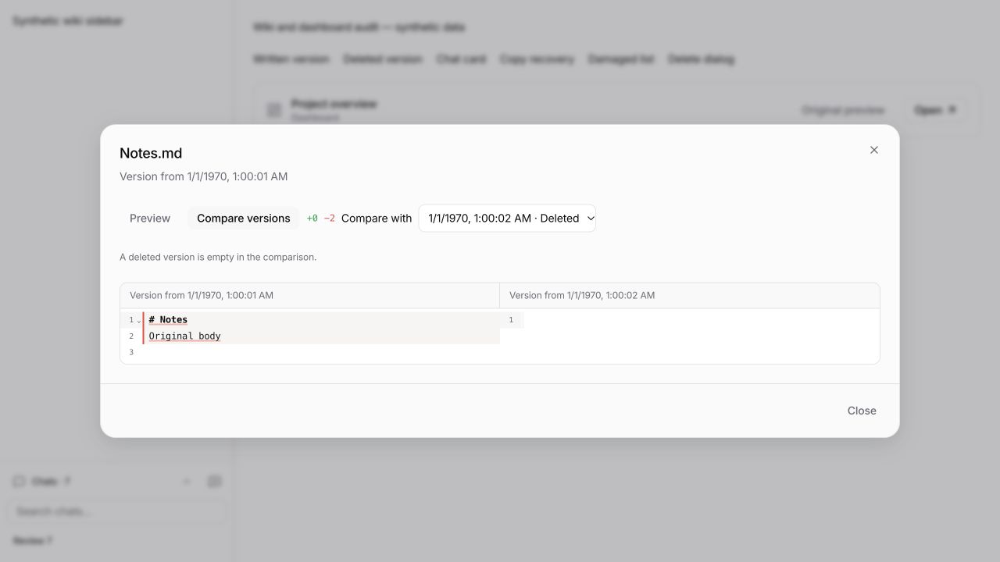
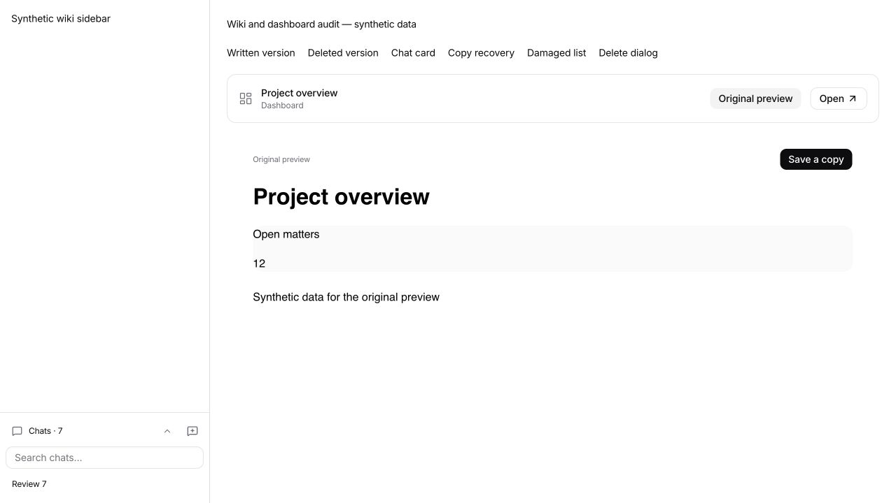
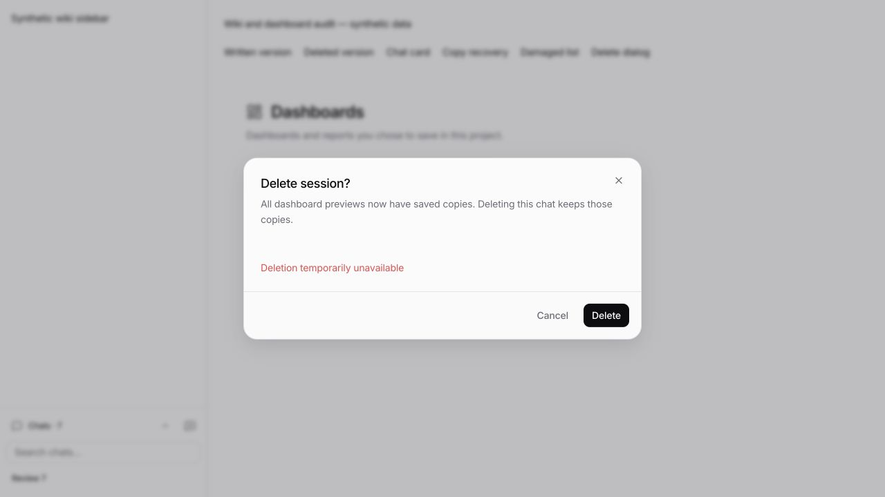
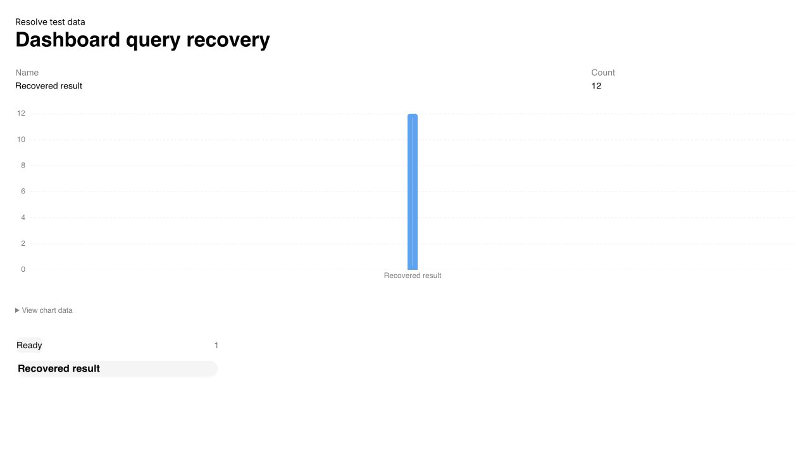

# Wiki and dashboard flow audit — 14 October 2026

Two independent GPT-6 Astra agents reviewed PR #280 at `32f0b24c948460ded836fcbec10bd341557dee46`, against `origin/codex/wiki-chat-editor-fixes`. One reviewed UI/UX; the other reviewed authorization, persistence, concurrency and data loss. Both were asked to report only evidenced problems, with no finding quota. They reviewed the fixes afterwards. The parent agent implemented the corrections, ran regressions and inspected real components in a neutral browser fixture.

## Findings and disposition

| Review | Confirmed problem | Correction |
| --- | --- | --- |
| UI · P2 | Comparing a write against its deletion showed `+0 / -0`, because the deletion record retains the old body. | Both sides use empty content for deletion comparisons. Preview still shows the recoverable body and explicitly says it predates deletion. Checked both directions: `+0 / -2` and `+2 / -0`. |
| UI · P2 | Deleting a saved dashboard file made the original chat card open only the missing file, although the preview was still in the transcript. | Saved cards retain **Original preview**, including after replay/reload. It renders the retained data and offers **Save a copy**, without trying to update the old target. |
| Tech · P1 | Verifying an inherited agent chat cached it as an independent owner; later ancestor downgrades no longer applied. | Descendants continue to inherit live scope. Verified parent links also propagate project-access revocation and abort signals, including pending approvals and running protected commands. Explicitly registered child sessions remain independent. |
| Tech · P2 | A dashboard with any live query was treated as saved even if its static datasets had changed. | Matching saved copies ignores only bindings regenerated by the same live queries; static bindings must match. |
| Tech · P2 | A generation could finish between the transcript snapshot and idle check, escaping the unsaved-dashboard warning. | Deletion reserves the chat and discovered descendants before checking idle and reading messages. Queued sends, direct sends, commands, scheduled sends and automatic review recovery participate in the same gate. Running/pending tools reject deletion; failed reviews release the gate without leaving queues paused. |

The technical recheck identified automatic review recovery as an additional path around the deletion gate. It now goes through a session-scoped server endpoint that rechecks the latest message and unfinished work and sends only the fixed recovery instruction using the original request's model/agent. The follow-up also caught the SDK's successful `204`/empty response being treated as a failure; the endpoint now checks response status and has a regression with a real SDK client and mock `204` response.

Final rechecks found no further actionable UI regressions or authorization problems in these fixes. This is a bounded review, not a claim that the entire application is defect-free.

## Systematic flow pass

| Flow | Coverage and outcome |
| --- | --- |
| Wiki navigation, contributions, page review/restore | Source review of entry points, cards, rendered previews, comparison and restore conflict handling. Existing contribution regressions pass; deletion comparison corrected and inspected in both directions. |
| Chats, search, resizing, reopening | Real sidebar component with seven chats. Previously a saved 88px height left a 0px list; minimum size now includes the search field and one row. With full wiki styles the list remains 37px high for a 34px row. Reopening preserves the corrected minimum. |
| Project files, approval/revocation, drops | Source and regression coverage; inherited revocation corrected. No live grants or user-file mutations during this pass. Native Electron drag gestures remain a manual check. |
| Graph properties and historical dashboards | Source review plus existing property/filter and snapshot regressions. No additional evidenced issue. |
| Generate → reopen → save/copy → remove saved file | Transcript replay retains original preview. Browser fixture exercised missing saved file → original preview → grouped copy dialog → save. |
| Copy loading, empty/error lists | Failed snapshot loading now offers Retry. Browser Retry reached the copy dialog. Damaged dashboard files show their errors without the contradictory “No saved dashboards yet” empty state. |
| Delete chat, partial success, retry | Spinner belongs to the chosen action. After saves succeed but deletion fails, the dialog explains that copies are kept and offers Delete instead of asking to save again. Busy save/restore/delete dialogs do not show an apparently usable close control. Browser fixture verified both action states and successful retry. Server tests cover children, stale discard tokens, concurrent sends and review recovery. |

Dedicated sources/citation UI and Home dashboard widgets remain out of scope.

## Browser evidence

Actual React components, synthetic data and mocked client responses were used. No real chat was deleted, project access granted or dashboard file saved. Temporary fixture files, their test storage entries and browser tab were removed afterwards.







## Validation

```sh
pnpm --filter @legalwork/app exec bun test tests/wiki-review-diff.test.ts tests/wiki-tree.test.ts tests/view-save.test.ts tests/view-generation-sync.test.ts tests/project-view-navigation.test.ts tests/wiki-suggestions.test.ts tests/views.test.ts tests/viewer-file-drop.test.ts tests/wiki-drafts.test.tsx tests/wiki-tabs.test.ts tests/session-list-visibility.test.ts tests/wiki-graph-properties.test.ts
# 75 passed, 0 failed, 329 assertions

pnpm --filter legalwork-server exec bun test src/wiki/agent-access.test.ts src/views/session-previews.test.ts src/session-view-delete.e2e.test.ts src/session-execution-gate.test.ts src/session-message-queue.test.ts src/opencode-plugins/recover-empty-review-response.test.ts
# 57 passed, 0 failed, 255 assertions

pnpm --filter legalwork-server exec bun test src/wiki/project-access.e2e.test.ts src/wiki/native-project-guard.test.ts src/wiki/view-snapshots.test.ts src/agent-sandbox/proxy-gate.test.ts src/opencode-plugins/legalwork-review-tools.test.ts src/opencode-proxy-gate.test.ts
# 49 passed, 0 failed, 232 assertions

pnpm --filter @legalwork/app typecheck
pnpm --filter @legalwork/app test:i18n
pnpm --filter legalwork-server build
git diff --check
# Passed; 6,705 translation keys in en/de. Server build includes typechecking.
```

The real sandbox VM and native Electron drag gesture were not exercised. Earlier broad-suite graph-watcher and Lexical baseline failures remain recorded in the PR; this pass does not claim a green full repository suite.

## Restart follow-up: pending dashboard data

The final Electron restart exposed a separate runtime failure in an existing dashboard: OpenUI query references are temporarily `null` before resolving, but Table/Chart/Board assumed rows were already arrays. Their render error could remain in the component error boundary even after data arrived.

A regression first reproduced the `rows.slice` exception. Data components now wait for rows before mounting; an actually empty array still renders the ordinary empty state. A browser fixture with a deliberately deferred query showed loading first, then a populated table, bar chart and board after resolution, with no console errors. No user data was changed.



```sh
pnpm --filter @legalwork/openui exec bun test src/catalog.test.tsx src/law-firm-demo.test.tsx
# 11 passed, 0 failed, 75 assertions

pnpm --filter @legalwork/app typecheck
# Passed
```
