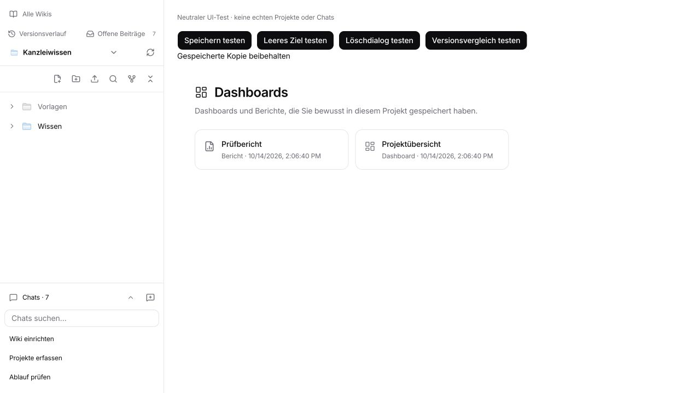
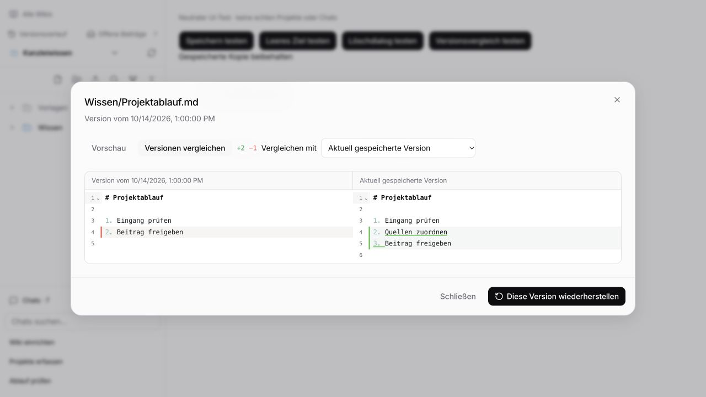
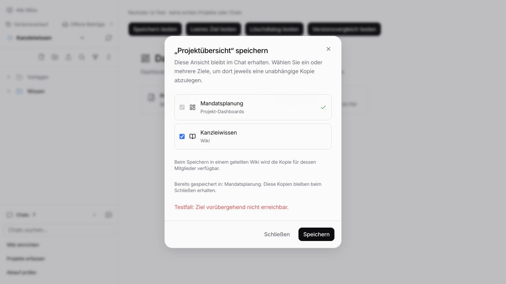
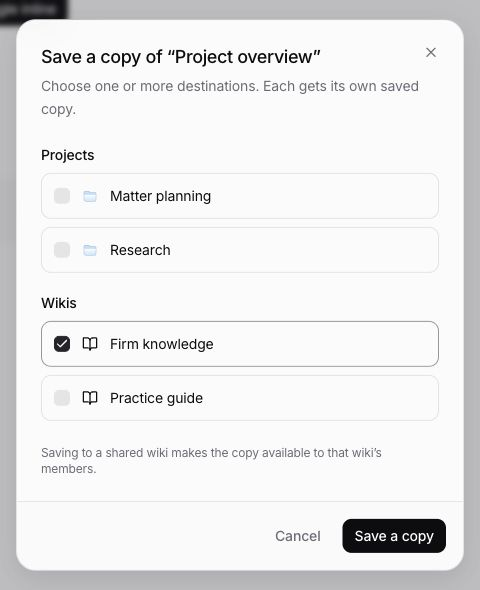

# Wiki UI follow-up — 14 October 2026

## Changes

- Version history is on the left; pending contributions are on the right.
- Contribution comparisons say **Compare with wiki page**. Both contribution and historical comparisons label their left/right content directly. History cards say **Open version**. Comparison statistics are shown with the comparison, rather than an unlabeled count in the rendered preview.
- Preview/compare/edit controls expose their selected state to assistive technology. Wiki navigation and project-file rows have visible keyboard focus.
- Chat search distinguishes no matches from no chats, offers Clear search, and stays visible while a filter is active even if the list becomes shorter. The chat count does not show a misleading zero before loading completes.
- Save dialogs name the dashboard, explain missing destinations, and identify successful partial saves. After partial success, Close accurately describes the action; saved copies remain. Save is disabled when there is no remaining selected destination or the destination list failed.
- Before deleting a chat, copy/sharing hints follow the selected destination. Destination errors and project-file loading errors offer Retry.
- Reports use the report icon; dashboard cards use a singular type label. Remaining reports/dashboard section text is localized in English and German.

## Browser evidence

The screenshots show the actual React components in a temporary fixture with synthetic wiki/project/chat data and mocked client responses. The fixture made no real project saves, chat deletions or access grants. It and its browser tab were removed afterwards.

- Inspected the navigation at 300px width: history left, pending contributions right, muted empty folder, Chats/New chat footer.
- Searched for a nonexistent chat; the no-match message and Clear search appeared. Clearing restored the list.
- Saved to a project and simulated a failure for the second wiki destination. The successful destination stayed checked/disabled, the error stayed visible, and Close retained the saved copy.
- Opened a save dialog with no available destinations; explanatory text appeared and Save was disabled.
- Opened a historical comparison, inspected the two labeled diff columns, chose another comparison version and returned to Preview; the unrelated diff count was no longer shown there.
- Changed the deletion dialog's destination from wiki to project; the wiki-sharing hint disappeared.







## Checks

```sh
pnpm --filter @legalwork/app exec bun test tests/wiki-review-diff.test.ts tests/wiki-tree.test.ts tests/view-save.test.ts tests/view-generation-sync.test.ts tests/project-view-navigation.test.ts tests/wiki-suggestions.test.ts tests/views.test.ts tests/viewer-file-drop.test.ts tests/wiki-drafts.test.tsx tests/wiki-tabs.test.ts tests/session-list-visibility.test.ts tests/wiki-graph-properties.test.ts
# 75 passed, 0 failed, 328 assertions

pnpm --filter @legalwork/app typecheck
# Passed

pnpm --filter @legalwork/app test:i18n
# Passed: 6,685 keys in both en/de

git diff --check
# Passed
```

## Wiki entry transition

The Wiki navigation button previously visited `/wikis`, mounted the manager, then redirected in an effect to the remembered workspace. It now opens the known workspace directly, restoring its focused chat or page. While initial discovery or a legacy `/wikis` redirect is pending, the shared loading state replaces the manager. Explicit **All wikis**, empty lists and connection/error states retain the manager. Automatic redirects replace the intermediate route so Back does not bounce into the wiki again.

Validation: app typecheck and `git diff --check` passed; the existing route, wiki-tab, shared navigation history and wiki navigation tests passed (**25 tests, 131 assertions**):

```sh
pnpm --filter @legalwork/app exec bun test tests/workspace-routes.test.ts tests/wiki-tabs.test.ts tests/panel-navigation-history.test.ts tests/wiki-navigation-regression.test.ts
pnpm --filter @legalwork/app typecheck
git diff --check
```

The native desktop interaction check was blocked by a macOS ScreenCaptureKit capture failure, so this transition has not been visually verified. To check: leave a wiki page or chat open, switch to Home, then click Wiki repeatedly. The same workspace should open without showing the manager. Back should return to Home in one step. **All wikis** should still open the manager; opening `/wikis` after a cold start should show a loading state until discovery completes, then restore a wiki or show the genuinely empty manager.

This follow-up changes client presentation and recovery feedback. It does not rerun the full repository suite or the sandbox VM flow; the wider validation results and known baseline failures remain recorded in PR #280. Native Electron drag gestures are still a manual check.


## Dashboard save follow-up

Save actions now say **Save** / **Save a copy**, without an ellipsis. The copy dialog also names itself and its final action as a copy, while a first save keeps the ordinary Save wording.

Destinations are separated into **Projects** and **Wikis**, with folder/book icons and the shared checkbox component. Redundant per-row type labels are removed. The same grouping appears in the destination selector before chat deletion; both dialogs use the same destination query and grouping helper.

Saved dashboard toolbars keep Copy and Refresh together. Preview progress/failure messages describe a preview rather than incorrectly expecting an automatically saved file; these labels and the toolbar actions are localized.

Browser verification used a temporary neutral fixture with real components and mocked clients. Checked the grouped copy dialog, whole-row checkbox activation, first-save wording, saving to both a project and wiki, and the grouped selector before deletion. Also inspected the compact toolbar in inline mode. No real files or chats were modified. The fixture and browser tab were removed.



```sh
pnpm --filter @legalwork/app exec bun test tests/view-save.test.ts tests/view-generation-sync.test.ts tests/views.test.ts tests/project-view-navigation.test.ts
# 36 passed, 0 failed, 143 assertions

pnpm --filter @legalwork/app typecheck
# Passed

pnpm --filter @legalwork/app test:i18n
# Passed: 6,701 keys in both en/de

git diff --check
# Passed
```
