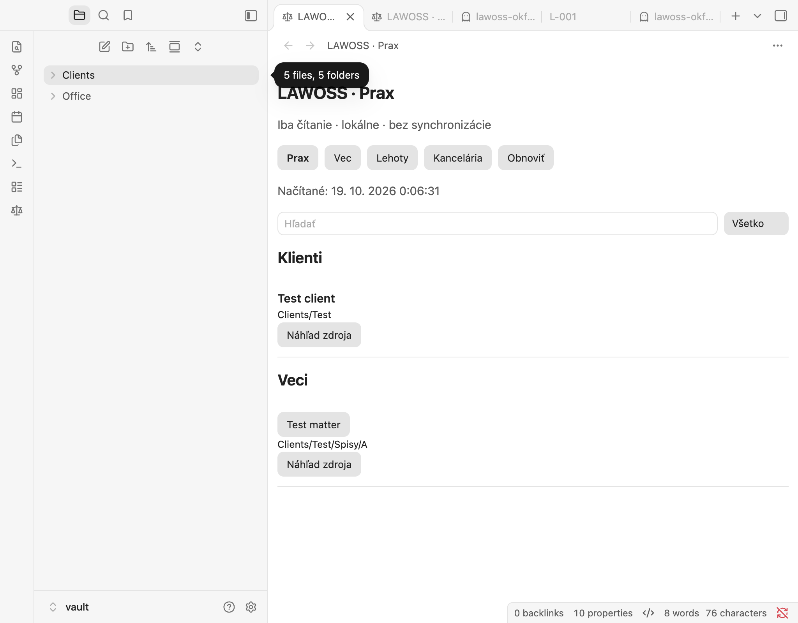
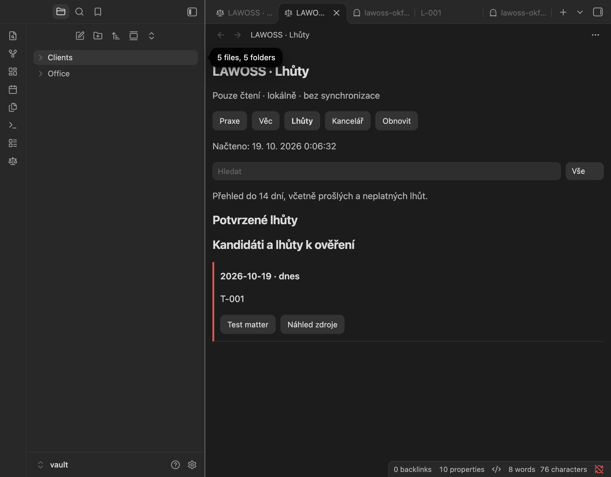

# Dôkazy desktop pilotu

Overené 18./19. 10. 2026. Zámerne oddeľujeme source test, natívny syntetický pilot a akceptáciu kancelárie.

## Overené lokálne

| Vrstva | Dôkaz |
| --- | --- |
| Reader + plugin | 23 behavior/host/DOM testov PASS; spolu s existujúcimi paritnými app testmi 106 PASS |
| App regresie | 2597 PASS / 2 platform SKIP / 0 FAIL |
| Pamäťové jadro | 676 PASS / 2 SKIP / 0 FAIL |
| Kontroly | Reader/app/plugin typecheck, plugin lint, browser reader build a desktop plugin build PASS |
| Artefakt | Manuálny ZIP, validovaný manifest, presné cesty, SHA-256 archívu aj rozbalených súborov; opakované balenie totožné |
| macOS runtime | Izolovaný Obsidian 1.14.4, aktualizovaný ASAR z oficiálneho release; SHA-256 gzipu zhodný s GitHub release digest `d1ed428c363968774f0f3906e67d8a53a058ece0b6cdd924b07865977b2ada21` |
| Natívne správanie | Load, CZ/SK, prepínanie existujúceho detailu A→B, kancelársky/klientsky náhľad a explicitný editor, zachovanie náhľadu pri rovnakých dátach |
| Udalosti | Skutočný externý zápis, presun celého priečinka a jeho zmazanie sa premietli bez ručného refreshu |
| Read-only | 7 obsahových súborov v čisto čítacej fáze malo zhodné pred/po hashy; 0 pozorovaných volaní obsahových Vault write API a fetch |
| Rozsah | Zmena na nedostupný koreň odmietla zdroj predošlej veci; automatická regresia pokrýva aj otvorenie editora čakajúce počas zmeny rozsahu/unload |

Pilot bežal iba v novom syntetickom vaulte a oddelenom `--user-data-dir`; bežný vault/profil sa neotváral ani nemenil. Počiatočný bootstrap Obsidianu mal verziu 1.10.3; načítaný aplikačný ASAR aj názov natívneho okna preukázali 1.14.4. To nie je inštalácia aktualizácie do bežného profilu.

Pozorované API volania a rovnaké hashy podporujú tvrdenie o testovanom behu. Nie sú OS sandboxom ani dôkazom, že žiadny iný plugin nemôže zapisovať či pristupovať na sieť. Externé zmeny v event testoch vykonal testovací driver zámerne; nepatria do čisto čítacej hashovej fázy.

## Natívne snímky (iba syntetické údaje)

## Ďalšie kroky

1. Tímové review spec 0018 a oboch produktových PR, úspešné povinné CI pred merge.
2. Natívny Obsidian GUI pilot na Windows nad rovnakými syntetickými dátami.
3. Pilot na lokálnej kópii reálneho vaultu, až potom osobitné rozhodnutie o živých dátach.

## Otvorené otázky

Windows GUI, pilot reálnej kancelárie, komunitný katalóg, mobil a právne posúdenie konkrétnej synchronizácie nie sú týmto záznamom potvrdené. Verejný release nebol vytvorený.
